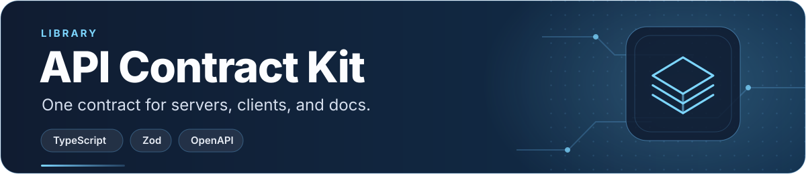

# 

Define HTTP endpoints once with Zod. Reuse the same contract for server-side validation, typed clients, and OpenAPI output.

[](https://github.com/svazqz/api-contract-kit/releases/latest) [](https://github.com/svazqz/api-contract-kit/actions/workflows/npm-publish.yml) [](https://github.com/svazqz/api-contract-kit/actions/workflows/ci.yml)

[Quick start](#quick-start) · [Validation](#validation) · [Project layout](#project-layout) · [Reference](#reference) · [License](#license)

## Quick start

Install the package and its schema dependencies in your application.

```sh
npm install @svazqz/api-contract-kit zod @asteasolutions/zod-to-openapi
```

Define an endpoint with `createAPIDefinition`, then connect a server adapter and a typed client. The [companion demo](https://github.com/svazqz/api-contract-kit-demo) walks through a complete Next.js integration.

## Validation

```sh
npm ci
npm test
npm run build
```

Run `npm run lint` for the ESLint checks.

## Project layout

| Path | Purpose |
| --- | --- |
| [`src/`](src/) | Contract definitions, runtime, adapters, and OpenAPI export |
| [`tests/`](tests/) | Automated behavior checks |
| [`CHANGELOG.txt`](CHANGELOG.txt) | Version history |

## Reference

Read the [project reference](README.reference.md) for detailed examples, configuration, and original notes.

## License

See [`LICENSE.md`](LICENSE.md) for license terms.
